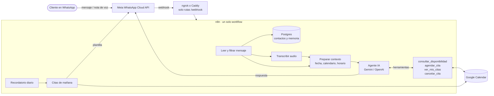

# Agente de citas por WhatsApp con IA

Asistente virtual que atiende a los clientes de un negocio por **WhatsApp**, consulta la disponibilidad real en **Google Calendar** y **agenda, muestra y cancela citas** en lenguaje natural, por texto o nota de voz. Corre sobre **n8n** autoalojado, con **Gemini** (o OpenAI) como modelo, y se instala con un par de scripts en un PC con Ubuntu/WSL o en un VPS.

> Proyecto funcionando de punta a punta: mensajes reales por la API de WhatsApp Cloud, citas creadas en Google Calendar y notas de voz transcritas.

```text
Cliente:  Quiero agendar para el martes
Agente:   El martes 20 de octubre tenemos disponibles a las 8:00 a. m., 9:00 a. m.,
          10:00 a. m., 11:00 a. m., 2:00 p. m., 3:00 p. m., 4:00 p. m. y 5:00 p. m.
          ¿Cuál de estos horarios te queda mejor?
Cliente:  A las 5 por favor
Agente:   ¡Listo! Tu *consulta general* quedó agendada para el *martes 20 de octubre
          a las 5:00 p. m.* ¿Te puedo ayudar con algo más?
Cliente:  🎤 (nota de voz) "¿Qué citas tengo?"
Agente:   Tienes una *consulta general* programada para el *martes 20 de octubre a las 5:00 p. m.*
```

## Qué hace

- **Agenda en lenguaje natural:** entiende "mañana en la tarde" o "el viernes", ofrece solo horarios realmente libres y confirma antes de crear la cita.
- **Consulta y cancela:** el cliente ve sus citas y cancela o reprograma sin dar IDs. Solo puede tocar las citas creadas desde su propio número.
- **Notas de voz:** las transcribe y las responde como si fueran texto.
- **Recordatorios automáticos:** cada día envía la plantilla `recordatorio_cita` a quienes tienen cita al día siguiente.
- **Reglas del negocio en código:** horario por día, duración, anticipación mínima, máximo de citas por cliente, días hacia adelante y **festivos de Colombia** (Ley Emiliani y Pascua calculados).
- **Memoria por cliente:** recuerda la conversación y saluda distinto a quien escribe por primera vez (con enlace a la política de datos).
- **Robustez:** descarta mensajes duplicados de Meta, permite pausar el bot por cliente (atención humana) y maneja errores de herramientas sin inventar respuestas.
- **Dos proveedores de IA:** Gemini (con plan gratuito) u OpenAI, eligiendo con una línea de configuración.

## Arquitectura



### Decisiones de diseño

- **El modelo conversa; el código decide.** Toda la lógica de horarios, festivos, permisos y choques de agenda está en nodos Code con pruebas. Al modelo solo le llega un texto corto como "libres: 8:00, 9:00…" o "ese horario ya está ocupado". Eso evita citas inventadas y permite usar un modelo pequeño y barato.
- **Herramientas en el mismo workflow.** El agente llama al propio workflow con una `accion`, así todo se importa y versiona como un único archivo.
- **Workflow generado, no editado a mano.** `desarrollo/build.js` produce el JSON de n8n a partir de los archivos `code/*.js`, que tienen pruebas propias (29 casos).
- **Instalación sin clics.** Las credenciales se importan con IDs fijos, así cada nodo queda conectado sin configurarlo en la interfaz. Reimportar conserva la sesión de Google ya autorizada.
- **Seguridad por defecto.** El editor de n8n solo escucha en `localhost`. El túnel público solo deja pasar `/webhook*` (política de tráfico de ngrok). Las claves viven en un único `configuracion.json` con permisos `600` y fuera del repositorio.

## Stack

| Capa | Tecnología |
|---|---|
| Orquestación | n8n 2.x (AI Agent, Postgres Chat Memory, Code, HTTP) |
| Modelo | Google Gemini 3.5 Flash-Lite · alternativa OpenAI |
| Mensajería | WhatsApp Business Cloud API (Graph v25) |
| Agenda | Google Calendar API (OAuth2) |
| Datos | PostgreSQL 16 |
| Infraestructura | Docker Compose · ngrok (local) o Caddy + HTTPS (VPS) · WSL/Ubuntu |
| Scripts | Bash, Python 3, Node.js |

## Costos de operación

| Concepto | Costo |
|---|---|
| n8n, Postgres, Docker | Gratis (autoalojado) |
| Modelo (Gemini) | Plan gratuito con límites, o unos US$3 por cada 1.000 mensajes con facturación |
| WhatsApp | Responder dentro de la ventana de 24 h es gratis; los recordatorios se cobran como plantilla de utilidad |
| Servidor | PC propio (ngrok gratis) o un VPS desde ~US$5/mes |

## Instalación rápida

Requisitos: Ubuntu 22.04+ (o WSL2), una app de Meta con WhatsApp, un proyecto de Google Cloud con la Calendar API y una API key de Google AI Studio.

```bash
git clone https://github.com/JuanjoZarama/agente-citas-whatsapp.git
cd agente-citas-whatsapp

# 1. Servicios (modo local con túnel ngrok gratuito)
sudo bash instalar-local.sh tu-dominio.ngrok-free.dev
#    o en un VPS con dominio propio: sudo bash instalar.sh citas.tudominio.com correo@tudominio.com

# 2. Configuración
cp configuracion.plantilla.json configuracion.json   # llena negocio, whatsapp, google e ia
bash meta.sh verificar && bash meta.sh suscribir && bash meta.sh plantilla

# 3. Importar a n8n
sudo bash importar.sh
```

En n8n (`http://localhost:5678`): conecta la credencial **Google Calendar (citas)** con *Sign in with Google* y pulsa **Publish** en el workflow.

### Utilidades

| Comando | Para qué |
|---|---|
| `bash meta.sh cuentas` | Lista cuentas y números de WhatsApp con sus IDs |
| `bash meta.sh usar <waba_id> <phone_number_id>` | Cambia el número que usa el bot |
| `bash meta.sh plantillas` | Estado de aprobación de las plantillas |
| `sudo bash diagnostico.sh` | Errores y respuestas de herramientas de las últimas ejecuciones |
| `sudo bash importar.sh --actualizar-workflow` | Aplica cambios de configuración al workflow |
| `sudo bash respaldo.sh` | Respaldo de las bases y de n8n (también corre a diario con cron) |
| `windows/mantener-activo.ps1` | Mantiene WSL encendido en Windows para que el bot responda siempre |

## Estructura

```text
├── instalar-local.sh / instalar.sh   Instalación en PC (ngrok) o VPS (Caddy + HTTPS)
├── importar.sh                       Valida la configuración y carga credenciales y workflow en n8n
├── meta.sh                           Atajos de la API de WhatsApp (token, números, plantillas, pruebas)
├── diagnostico.sh / respaldo.sh      Operación diaria
├── docker-compose*.yml               Servicios: Postgres, n8n, ngrok o Caddy
├── lib/                              Validación de configuración, base de datos y utilidades
├── workflow/                         Workflows generados (Gemini y OpenAI)
├── windows/                          Script para mantener WSL activo
└── desarrollo/                       Generador del workflow, código de los nodos y pruebas
```

## Desarrollo

```bash
cd desarrollo
npm install
npm test        # 29 pruebas de la lógica de agenda, festivos, contexto y transcripción
npm run build   # regenera workflow/*.json desde code/*.js
```

`validate.js` revisa cada nodo contra las definiciones reales de n8n instalado: `node validate.js ../workflow/agente-citas-whatsapp.json <ruta a node_modules de n8n>`.

## Próximos pasos

- Varios profesionales o cupos por franja horaria.
- Observabilidad del agente con Langfuse (trazas, costos, evaluación).
- Respuestas a preguntas frecuentes con RAG sobre documentos del negocio.
- Panel para que el negocio pause el bot y vea métricas de citas.

## Autor

**Juanjo Zarama** · desarrollador web e IA · [juanjozarama.github.io](https://juanjozarama.github.io)

Licencia [MIT](LICENSE).
